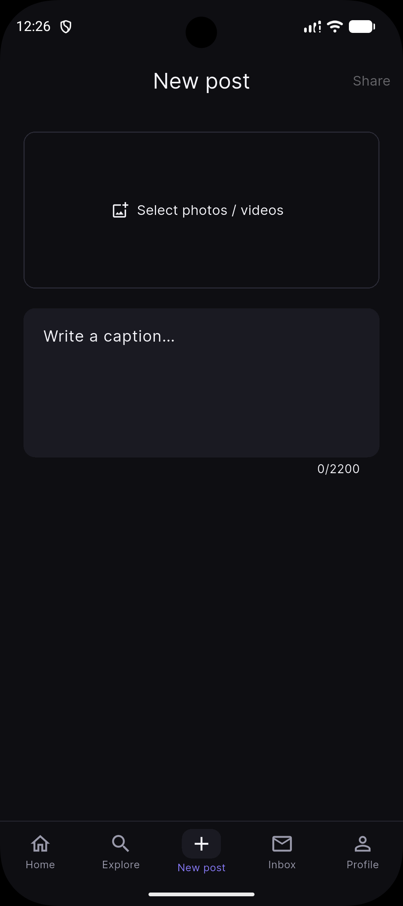
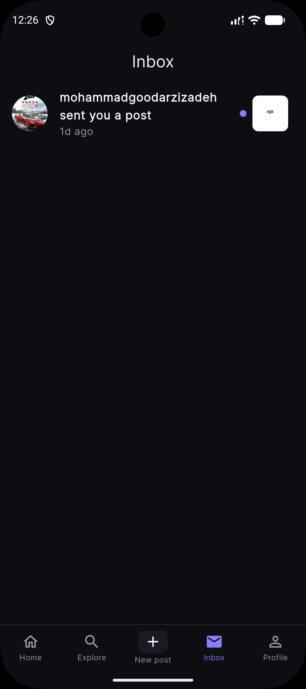
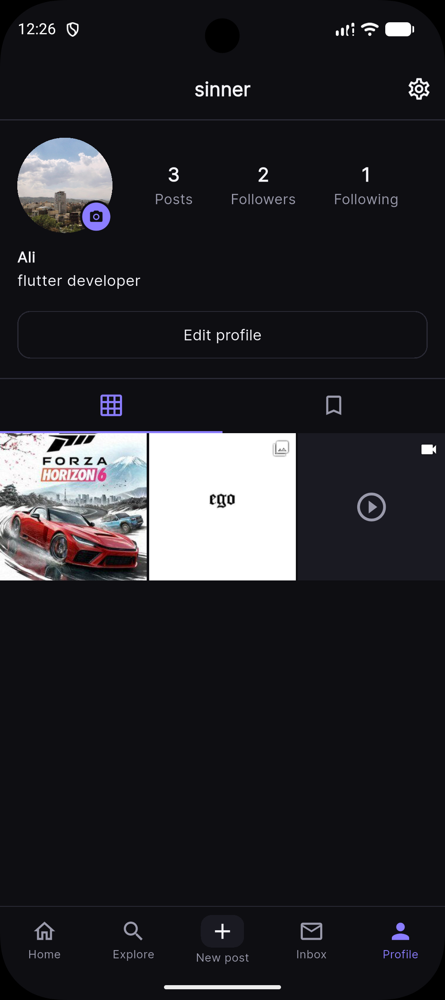
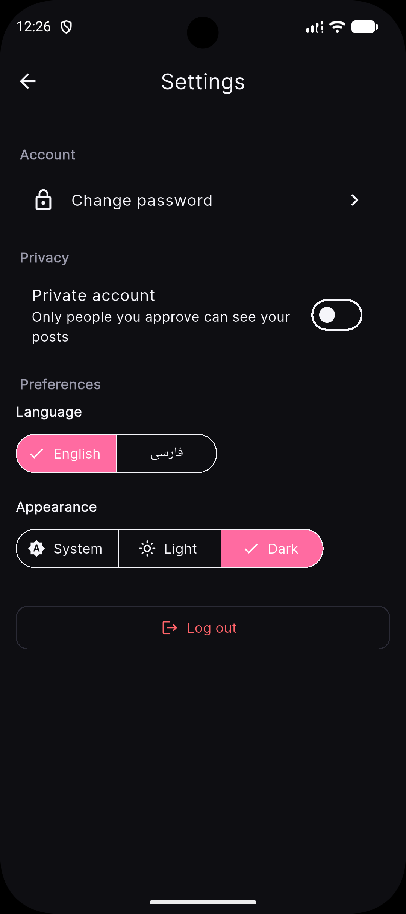

# VXGram

An Instagram-style social media app built with **Flutter** (BLoC, clean layered architecture) and **Supabase** (Postgres, Auth, Storage, Realtime).
Supports English and Farsi (RTL), and light and dark mode.

> **University project** — Islamic Azad University, Tehran North Branch (دانشگاه آزاد اسلامی واحد تهران شمال)
> **Student:** Mohammad Goodarzizadeh (محمد گودرزی‌زاده)
> **Supervisor:** Sina Yaghoub Karaji (سینا یعقوب کرجی)

## Screenshots

| Feed | Explore | New post |
|:---:|:---:|:---:|
|  |  |  |

| Inbox | Profile | Settings |
|:---:|:---:|:---:|
|  |  |  |

## About the app

VXGram lets users share photos and videos with people they follow. After signing up, a user gets a profile, can publish posts, follow other users, and interact with content through likes, comments, saves and direct post sharing. Accounts can be public or private, in which case followers must be approved.

The app is designed for mobile (Android and iOS) with a dark-first interface, and the whole UI can be switched between English (LTR) and Farsi (RTL).

## Features

- **Authentication:** sign up, log in, reset password, change password, onboarding
- **Feed:** photo and video posts, **slideshow** for multi-media posts, like, comment, copy link, share, bookmark
- **Create post:** up to 10 photos/videos per post, caption (up to 2200 characters), upload progress, automatic thumbnails, rollback if the upload fails
- **Explore:** grid of posts and username search
- **Profiles:** post / follower / following counts, follow and unfollow, **private accounts** with follow requests, followers and following lists, edit profile, avatar, delete own posts, saved posts
- **Inbox:** send a post to another user and receive posts from others
- **Notifications:** likes, comments, follows, follow requests (confirm / delete from the list), accepted requests, and an unread badge on the heart icon
- **Settings:** change password, private account switch, language (English / فارسی), appearance (System / Light / Dark), log out

## Tech stack

| Layer | Technology |
|---|---|
| Frontend | Flutter, Dart |
| State management | BLoC / Cubit |
| Backend | Supabase (PostgreSQL, Auth, Storage, Realtime) |
| Security | Row Level Security policies, database triggers and RPC functions |
| Localization | English and Farsi with RTL support |
| Testing | `flutter_test` with fake repositories |

## Architecture

```
vxgram/
  frontend/vxgram/   Flutter app
  backend/           Supabase migrations (see backend/README.md)
```

Each feature in `lib/features/<name>/` is split into layers:

```
domain/  ->  data/  ->  bloc/  ->  ui/
repository interface    data source interface +      cubits /     pages and
and entities            Supabase implementation,     states       widgets
                        models, repository impl.
```

`main.dart` is the only file that knows the concrete classes, so every layer can be tested with fakes.

On the backend, counters (posts, likes, comments, followers) are maintained by database triggers, and clients cannot write them directly. Access to posts and profiles is controlled with Row Level Security.

## Getting started

### Requirements
- Flutter SDK (stable) and Android Studio or Xcode
- A free [Supabase](https://supabase.com) project

### Steps
1. Create a Supabase project and apply the migrations in order (`vxgram/backend/README.md`), for example from the SQL Editor.
2. Put your Project URL and **anon** key in `vxgram/frontend/vxgram/lib/core/env.dart`
   (or pass `--dart-define=SUPABASE_URL=... --dart-define=SUPABASE_ANON_KEY=...`).
3. Run the app:
   ```
   cd vxgram/frontend/vxgram
   flutter pub get
   flutter test
   flutter run
   ```

> Never commit your Supabase **service_role** key. Only the public anon key belongs in the app.

## Tests

BLoC / cubit tests use fake repositories (`test/fakes/`), so they need no network and no Supabase.

```
flutter test
```

## درباره پروژه (فارسی)

**VXGram** یک شبکه اجتماعی شبیه اینستاگرام است که با **Flutter** و **Supabase** ساخته شده است. کاربران می‌توانند عکس و ویدیو منتشر کنند، یکدیگر را دنبال کنند، پست‌ها را لایک، ذخیره و ارسال کنند و برای پست‌ها نظر بگذارند. حساب‌ها می‌توانند عمومی یا خصوصی باشند و برنامه از زبان فارسی (راست‌به‌چپ) و انگلیسی و حالت روشن و تیره پشتیبانی می‌کند.

این پروژه برای درس پروژه در **دانشگاه آزاد اسلامی واحد تهران شمال** توسط **محمد گودرزی‌زاده** با راهنمایی استاد **سینا یعقوب کرجی** انجام شده است.

## License and rights

© 2026 Mohammad Goodarzizadeh. **All rights reserved.**

This project was developed as a university course project. All rights to the source code, design and documentation belong to the author. No part of it may be copied, modified, distributed or used commercially without the author's written permission.

تمام حقوق این اثر برای صاحب اثر (محمد گودرزی‌زاده) محفوظ است.
